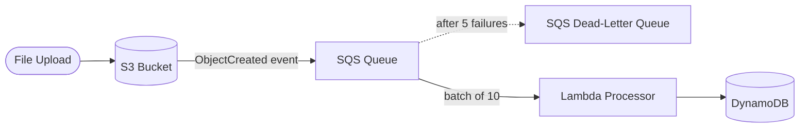

# AWS Event-Driven Processing Pipeline (Terraform)

> Decoupled, event-driven pipeline: S3 upload → SQS → Lambda → DynamoDB, with a dead-letter queue — provisioned with Terraform.
> **Author:** Muhammad Ahmad · **IaC:** Terraform · **Cloud:** AWS


---

## 📌 Overview

When a file lands in the S3 bucket, the pipeline reacts automatically:

1. **S3** emits an `ObjectCreated` event to an **SQS queue** (durable buffer).
2. **Lambda** consumes messages from the queue in batches.
3. It writes each object's metadata (key, bucket, size) to **DynamoDB**.
4. Messages that fail 5 times move to a **dead-letter queue** for inspection.

SQS decouples producer from consumer, absorbs spikes, and gives retries + DLQ for free.

## 🏗️ Architecture



## 🚀 Deploy & test

```bash
cd terraform
terraform init
terraform apply

# Upload a file to trigger the pipeline
aws s3 cp ./README.md s3://$(terraform output -raw uploads_bucket)/

# Check the stored metadata
aws dynamodb scan --table-name $(terraform output -raw dynamodb_table)
```

## 🧹 Clean up

```bash
terraform destroy
```

## 💰 Cost note

S3, SQS, Lambda, and on-demand DynamoDB are all pay-per-use — idle cost ≈ **$0**.

## 🔐 Production hardening (next steps)

- Add **S3 → EventBridge** for richer routing.
- Add **DLQ alarms** (CloudWatch) and a redrive runbook.
- Enable **SQS SSE** and bucket default encryption.

---

*Built and maintained by **Muhammad Ahmad**.*
