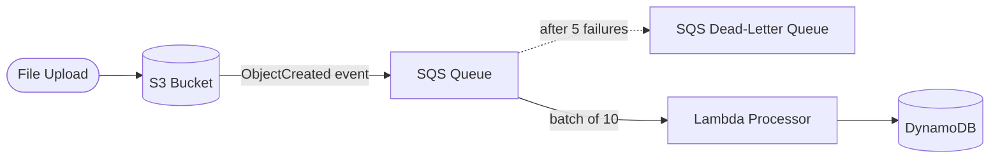

# Architecture Diagram — AWS Event-Driven Processing

## Lucid diagram

- **View:** https://lucid.app/lucidchart/017f60c4-39bd-4aac-8ae1-34805693edee/view
- **Edit:** https://lucid.app/lucidchart/017f60c4-39bd-4aac-8ae1-34805693edee/edit

## Lucid prompt (reusable)

```
Create an AWS architecture diagram titled "AWS Event-Driven Processing".
Left to right: a File Upload goes to an S3 Bucket; S3 emits an ObjectCreated event to
an SQS Queue; a Lambda Processor consumes batches from the queue and writes to a
DynamoDB table; failed messages after retries go to an SQS Dead-Letter Queue.
Label the arrows. Clean, professional AWS colors.
```

## Mermaid source


